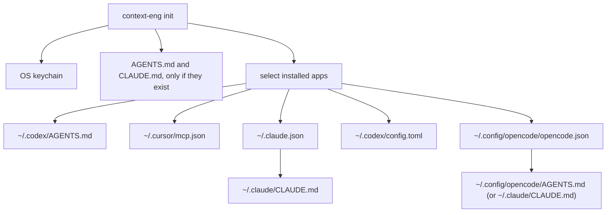
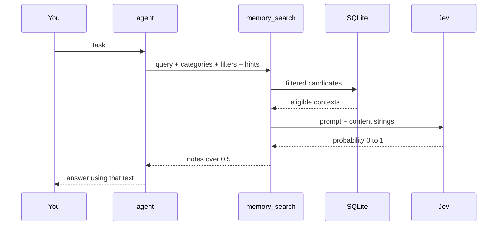
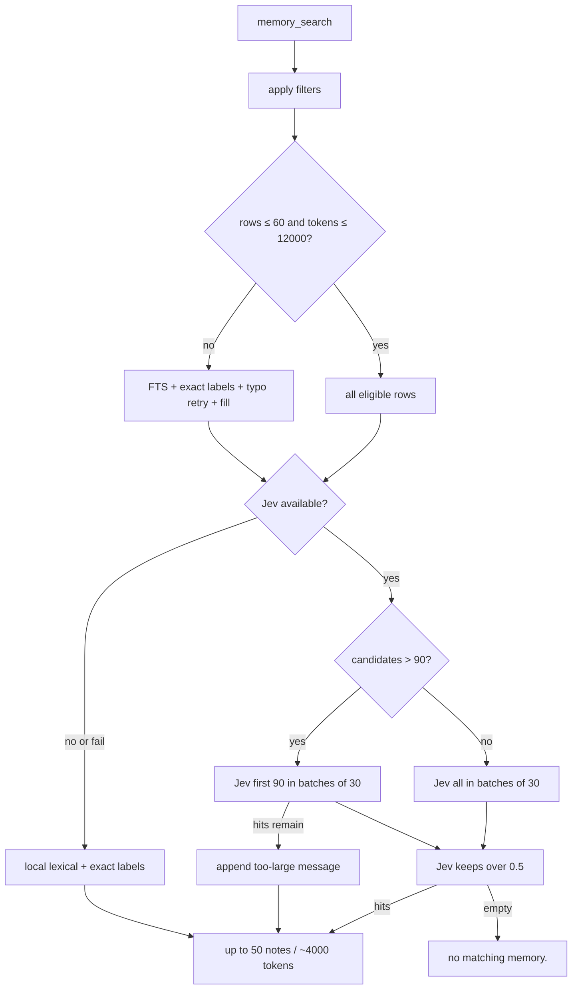

# context-eng 

Local project memory router for Codex, Claude Code, Cursor, and OpenCode. Memories live in one SQLite database per each category, with SQLite FTS5 for local retrieval and TypeSafe Jev filtering for semantic relevance.

## Use

- Requires Node.js 20 or newer.
- Run the command from within your project repository, not from your home directory.

### Install (recommended)

Install the command globally, then run setup:

```sh
npm install -g context-eng@latest --prefer-online --registry https://registry.npmjs.org &&
context-eng init
```

The `&&` runs setup only if installation succeeds. Restart Claude Code, Codex, Cursor, or OpenCode after setup so they load the memory tools. To enable manual saving as well, see [Save a learning manually](#save-a-learning-manually).

A global install matters: `init` then writes the full path to `node` and to the installed `context-eng` into your app configs. Your apps start that exact file, in any folder, with no download and no lookup.

### Try without installing

```bash
npx context-eng@latest init
```

```bash
pnpm dlx context-eng init
```

This works, but the apps then start the server with `npx -y context-eng mcp`, and `init` prints a warning. `npx` finds the package by name starting from the current folder. So inside any folder whose `package.json` is also named `context-eng`, it runs that folder's code instead. Install globally when you keep using it.

### Update

```sh
npm install -g context-eng@latest --prefer-online --registry https://registry.npmjs.org
```

Then restart Claude Code, Codex, Cursor, or OpenCode so they load the new version, and run `context-eng doctor`. You only need to rerun `context-eng init` if you also switched Node versions.

From a checkout of this repo, `npm run update-device` does the same install, repairs a stale vite-plus `context-eng` link if it finds one, prints the installed version, and runs `doctor`.

### Check your setup: `context-eng doctor`

```sh
context-eng doctor
```

`doctor` only reads files. It never changes them. It checks every place that starts context-eng:

- MCP servers in `~/.claude.json`, `~/.cursor/mcp.json`, `~/.codex/config.toml`, and OpenCode's `opencode.json`/`opencode.jsonc` (in `~/.config/opencode/`, the project root, and the project's `.opencode/`). A `.jsonc` file with comments that mentions `context-eng` is reported as `WARN`, because `doctor` cannot read JSONC
- prompt hooks in `~/.claude/settings.json`, `~/.codex/hooks.json`, and the current project's `.claude/` and `.codex/` hook files

Each line is `ok`, `WARN` (starts through `npx`/`pnpm dlx`), or `ERROR` (points at a file that no longer exists, for example after you switch or remove a Node version). It exits with code 1 when it finds a problem. Use `--project <path>` to check another project's hook files.

### Fix common problems

| Symptom | Cause | Fix |
|---|---|---|
| `doctor` shows `ERROR ... missing .../bin/node` | You upgraded or removed the Node version context-eng was installed with | `npm install -g context-eng`, then `context-eng init` (and `context-eng init --recall manual` if you use hooks) |
| `doctor` shows `WARN ... uses npx` | Setup ran from `npx`/`pnpm dlx` | Install globally (above), rerun `context-eng init`, and say yes to replacing the old entry |
| Memory tools missing in the app | App not restarted, or setup skipped it | Restart the app; run `context-eng doctor` |
| `readlink ~/.vite-plus/bin/context-eng` points at an older Node version | A vite-plus update moved its link back | `npm run update-device` from the repo, or `ln -sf "$(npm prefix -g)/bin/context-eng" ~/.vite-plus/bin/context-eng` |
| `context-eng: refusing to start: N copies are already nested` | Something keeps starting context-eng in a loop; the copy limit stopped it | Run `context-eng doctor` and fix what it reports |
| CPU stuck at 100% with many `sh`/`context-eng` processes (versions before 0.1.4) | An old `npx` cache link plus a missing `#!` line made copies start copies | Quit the apps, run `pkill -STOP -f context-eng; pkill -KILL -f context-eng`, delete stale `~/.npm/_npx` folders, then install 0.1.4 globally and rerun `init` |

### Built-in safety (0.1.4+)

- Every file that can be run as a command starts with `#!/usr/bin/env node`, so the system always runs it with Node, never as a shell script.
- Copy limit: each run sets `CONTEXT_ENG_DEPTH`. context-eng never starts itself, so normal depth is 1. If copies start copies, the third nested copy exits at once (in a few milliseconds) instead of starting more.

### Uninstall

```sh
npm uninstall -g context-eng
```

Then remove the `context-eng` entry from `~/.claude.json`, `~/.cursor/mcp.json`, `[mcp_servers.context-eng]` in `~/.codex/config.toml`, and `mcp.context-eng` or `mcp.servers.context-eng` in `~/.config/opencode/opencode.json`. Also remove any hook whose command contains `context-eng` in `~/.claude/settings.json` or `~/.codex/hooks.json`, and the `recall.md`/`postsession.md` commands in `~/.config/opencode/commands/`. Your memories stay in `~/.context` (or `$CONTEXT_ENG_HOME`) until you delete that folder.

To set up a different folder than the one you are in:

```bash
context-eng init --project /path/to/repo
```

`init` asks for a TypeSafe API key. The prompt is hidden. Press Enter to skip. A saved key is kept if you press Enter again; type a new key to replace it. The key goes in the OS keychain (macOS Keychain, Windows Credential Manager, or libsecret), not into the project.

In a terminal, `init` lists Cursor, Claude Code, Codex, and OpenCode. Installed ones start selected. Space turns one off. Enter writes a user-level MCP server only for the ones left selected. A different existing `context-eng` server needs an explicit yes before replacement. Without a terminal, `init` skips global instructions and editor servers unless you pass `--yes`; `--yes` adds missing servers but never replaces a different one. Restart an app after adding its server.




You do not start the server yourself. Cursor, Claude Code, Codex, or OpenCode runs `context-eng mcp`. With no `--project`, the server is global until a tool passes `projectPath` or calls `memory_bind`.

### Project and global

Two different splits:


|              | Project                                      | Global                                           |
| ------------ | -------------------------------------------- | ------------------------------------------------ |
| Memory       | This repo only, under `~/.context/projects/` | Every repo, under `~/.context/global/`           |
| Instructions | Files inside the repo                        | Files in your home directory, used by every repo |


`memory_search` with `filters.scope` `project`, `global`, or `both` chooses the memory side. The files below are the instruction side.

### Files `init` edits

Instruction files (`AGENTS.md`, `CLAUDE.md`, and the rule files below) keep your other text. `init` replaces only the block between `<!-- context-eng:start -->` and `<!-- context-eng:end -->`. The MCP config files are updated in place and keep other servers.


| File                                           | When                                                        | What it does                                                                                                         |
| ---------------------------------------------- | ----------------------------------------------------------- | -------------------------------------------------------------------------------------------------------------------- |
| OS keychain `context-eng` / `typesafe-api-key` | Always                                                      | Stores the TypeSafe key for this login                                                                               |
| `<project>/AGENTS.md`                          | Only if that file already exists                            | Tells Codex and OpenCode, in this repo, to use the memory tools                                                      |
| `<project>/CLAUDE.md`                          | Only if that file already exists                            | Tells Claude Code, in this repo, to use the memory tools                                                             |
| `~/.codex/AGENTS.md`                           | Terminal or `--yes`                                         | Same instructions for every Codex session                                                                            |
| `~/.claude/CLAUDE.md`                          | Claude server added or already matching, or `--claude-only` | Same instructions for every Claude Code project                                                                      |
| `~/.cursor/mcp.json`                           | Cursor selected                                             | Starts the server for every Cursor project. No `--project`                                                           |
| `~/.claude.json`                               | Claude selected                                             | Same for every Claude Code project. This is the file `claude mcp add --scope user` writes                            |
| `~/.codex/config.toml`                         | Codex selected                                              | Adds `[mcp_servers.context-eng]` only. Codex may later add `[mcp_servers.context-eng.tools.*]` approval lines itself |
| `~/.config/opencode/opencode.json`             | OpenCode selected                                           | Adds a `local` server. See [OpenCode](#opencode) for which config shape is written                                    |
| `~/.config/opencode/AGENTS.md`                 | OpenCode server added or already matching, or `--opencode-only` | Same instructions for every OpenCode session. Written to `~/.claude/CLAUDE.md` instead while OpenCode falls back to it |


`<project>` is `--project`, or the current directory when you omit it. It must already exist. Running `init` from `~` uses your home directory as `<project>`. It does not create `~/AGENTS.md` or `~/CLAUDE.md` when those files are absent. Claude's user-level MCP server is in `~/.claude.json`; `init` does not create a project `.mcp.json`.

### One app, or only the instruction files

These skip the key prompt and the MCP server write. They only update instruction files.

```bash
context-eng init --codex-only
context-eng init --opencode-only
context-eng init --cursor-only --scope global
context-eng init --cursor-only --project /path/to/repo
context-eng init --claude-only --scope both --project /path/to/repo
```


| Command         | Global file                              | Project file                                     |
| --------------- | ---------------------------------------- | ------------------------------------------------ |
| `--codex-only`  | `~/.codex/AGENTS.md`                     | none                                             |
| `--cursor-only` | `~/.cursor/rules/context-eng-memory.mdc` | `<project>/.cursor/rules/context-eng-memory.mdc` |
| `--claude-only` | `~/.claude/CLAUDE.md`                    | `<project>/.claude/rules/context-eng-memory.md`  |
| `--opencode-only` | `~/.config/opencode/AGENTS.md`, or `~/.claude/CLAUDE.md` while OpenCode falls back to it | none |


`--scope` is `global`, `project`, or `both`. With no `--project`, scope defaults to `global`. With `--project` and no `--scope`, scope defaults to `project`. `project` and `both` need `--project`.

`context-eng mcp` reads the keychain key when `TYPESAFE_API_KEY` is unset. Set `TYPESAFE_API_KEY` to override it. Set it empty to force local FTS5 search. `CONTEXT_ENG_HOME` overrides the default `~/.context` storage root.

## Recall from the agent prompt box

Prompt-box recall supports local Codex and Claude Code on macOS and Linux. OpenCode gets a manual, model-driven `/recall` command instead ([OpenCode](#opencode)). A `UserPromptSubmit` command hook fetches memories before the model processes the prompt. It calls the existing memory engine directly, so the model does not need to choose `memory_search` or run a terminal command.

After publishing a release that includes these integrations, install a durable copy and configure recall:

```sh
npm install -g context-eng@latest
context-eng init --recall manual
```

Setup selects detected Claude, Codex, and OpenCode hosts. Use `--harness claude`, `--harness codex`, or `--harness opencode` to target one directly. OpenCode gets a manual command rather than a hook; see [OpenCode](#opencode). This recall-only setup does not configure MCP or prompt for a key; ordinary `context-eng init` still handles MCP and the optional key. Temporary `npx`/`pnpm dlx` runtimes are rejected for hook installation because their cached files can disappear. A stable source checkout also works for development.

Restart the selected host after installation. Codex requires review and trust of the hook using `/hooks`; project-local Codex hooks also require trusting the project. Then invoke recall from the prompt box:

```text
Claude Code: /recall Fix login
Codex:       $recall Fix login
```

Codex also offers recall through its skill picker. The command displays fetched memories with their category, project, and update date, then waits. It does not start the task described by the query. If the hook is missing, the skill reports the setup problem instead of quietly falling back to model-driven retrieval.

To fetch memories before every prompt while keeping manual recall available:

```sh
context-eng init --recall automatic
```

Automatic recall adds context quietly, including an empty/error status to avoid a second lookup. It attempts semantic evaluation with a 1.5-second request deadline, falls back to local retrieval on failure, returns at most five whole memories within an approximate 1800-token budget for the exact `additionalContext` text supplied to the model, and has a five-second host timeout. The outer hook JSON is only transport and does not consume this budget. The existing MCP relevance timeout is unchanged. With a configured relevance key, automatic mode sends each prompt and candidate memory text to that service. Add `--local` during setup to skip the keychain and external service.

Disable our integration with `context-eng init --recall off`. Setup preserves unrelated settings, hooks, and skills. Before it changes the recall files, it records their contents and permissions; if a later file write or removal fails, it restores completed changes in reverse order. If another process changed a completed file first, setup preserves that newer content and reports the remaining partial change instead of overwriting it. Rollback also checks symbolic-link targets: if a link was redirected, it leaves the link and its new target untouched and reports the remaining partial change, even when the target contains identical text. A conflicting user-owned recall skill or malformed config is left unchanged. Repeating setup updates the owned handler without adding another one. Do not install both project and global recall for the same host; setup checks the current project's opposite scope and refuses a duplicate.

Global setup writes these files:

| Host | Hook configuration | Skill |
| --- | --- | --- |
| Claude Code | `~/.claude/settings.json` | `~/.claude/skills/recall/SKILL.md` |
| Codex | `~/.codex/hooks.json` | `~/.agents/skills/recall/SKILL.md` and `agents/openai.yaml` |

Use `--scope project --project /path/to/repo` for project setup. It writes `.claude/settings.local.json` or `.codex/hooks.json` and the corresponding skill directory inside that project. Project hooks bind to that root even from nested working directories. Global hooks use the event's current directory; use project setup when a nested directory should share the repository root's memory. Disabling uses the same scope/project flags as installation. Keep one installation scope per host across your projects.

### OpenCode

`context-eng init` detects OpenCode (`opencode` on PATH, `~/.config/opencode`, or `~/.opencode`) and adds a `local` MCP server to `~/.config/opencode/opencode.json`. If that file is missing and `opencode.jsonc` exists, it edits `opencode.jsonc` instead. `$XDG_CONFIG_HOME/opencode` is used when `XDG_CONFIG_HOME` is set.

- **Config shape.** If the file already keeps servers under `mcp.servers` (OpenCode V2), the entry goes there. Otherwise it is written as `mcp.context-eng`. OpenCode V1 reads that shape, and V2 still accepts it and migrates it. Either way the entry is `{ "type": "local", "command": [node, cli-entry.js, "mcp"] }`.
- **JSONC files.** `init` does not edit a JSONC file with comments. It reports an error and leaves the file unchanged, so add the entry by hand.
- **Tool names.** OpenCode names the tools `context-eng_memory_search`, `context-eng_memory_create`, and so on.

OpenCode's global rules file is `~/.config/opencode/AGENTS.md`. While that file does not exist, OpenCode reads `~/.claude/CLAUDE.md` instead. Creating `AGENTS.md` would hide those instructions, so in that case `init` writes the memory pointer into `~/.claude/CLAUDE.md`. Set `OPENCODE_DISABLE_CLAUDE_CODE=1` or `OPENCODE_DISABLE_CLAUDE_CODE_PROMPT=1` to turn that fallback off; `init` then creates `AGENTS.md`.

OpenCode has no shell prompt hook, so recall and postsession are installed as [custom commands](https://opencode.ai/docs/commands/) instead:

```sh
context-eng init --recall manual --harness opencode
context-eng init --postsession manual --harness opencode
```

| Scope | Files |
| --- | --- |
| global (default) | `~/.config/opencode/commands/recall.md` and `postsession.md` |
| `--scope project --project <path>` | `<path>/.opencode/commands/recall.md` and `postsession.md` |

- **Model-driven recall.** Restart OpenCode, then type `/recall Fix login` or `/postsession`. `/recall` asks the model to call `memory_search` once, show the results, and wait. Unlike the Claude and Codex hooks, the model runs the search itself, so the MCP server must be connected.
- **Manual only.** There is no automatic mode: `--recall automatic --harness opencode` is an error. When OpenCode is only auto-detected next to Claude or Codex, it gets manual `/recall`. `--local` does not apply, because the MCP server handles relevance filtering.
- **No runtime needed.** The commands contain no runtime paths, so they also work from `npx`.
- **Ownership.** A command file that context-eng did not write is never overwritten. `--recall off` and `--postsession off` remove only context-eng's own files.
- **Claude skills also show up.** OpenCode also loads skills from `~/.claude/skills` and `~/.agents/skills`. Recall and postsession skills installed for Claude or Codex therefore appear in OpenCode as `@recall` and `@postsession`. The commands above are the OpenCode way to use them.

Cursor's documented `beforeSubmitPrompt` hook cannot add memory context, so recall setup does not install a Cursor adapter. Remote/cloud hosts need the runtime and memory data in their own execution environment; installing locally does not deploy them there. Rerun setup after moving the checkout or changing the installed Node path.

### Test an unpublished checkout

For an existing throwaway project directory, install directly from this checkout without publishing or building:

```sh
node --import tsx src/cli-entry.ts init --recall manual --harness claude --scope project --project /path/to/test-project --local
node --import tsx src/cli-entry.ts init --recall manual --harness codex --scope project --project /path/to/test-project --local
```

Use the commands in each real host's prompt box with a topic already stored for that test project. Check hook delivery in the host's hook/debug view and verify the first response has the memory without a `memory_search` call. Switch to automatic mode and submit two different topics in succession to verify recall runs before both prompts. Finally disable the project integration and check unrelated hooks remain.

To configure recall and manual saving for this checkout in Codex, run these commands from the repository root:

```sh
node --import tsx src/cli-entry.ts init --recall automatic --harness codex --scope project --project . --local
node --import tsx src/cli-entry.ts init --postsession manual --harness codex --scope project --project .
```

This creates `.codex/hooks.json` with `UserPromptSubmit` for recall and installs `.agents/skills/recall/` and `.agents/skills/postsession/`. Manual postsession has no hook. Its setup removes any legacy context-eng Stop handler in the selected scope, while preserving recall and unrelated Stop handlers. Recall's generated hook uses absolute paths to the local Node executable and checkout. Postsession uses the working model and requires connected, permitted context-eng memory tools.

1. Restart Codex or reopen the project. Open `/hooks` and review/trust the recall hook. Project hooks also require project trust.
2. In this project, use the memory tools to save one known note, such as `The project test colour is violet.`, and confirm it is searchable. A fact mentioned only in chat is not yet a saved context-eng memory.
3. Open a fresh chat in the same project and type `$recall test colour`. The saved note should appear with its metadata, and the agent should wait. There should be no `memory_search` call before that first reply.
4. Open another fresh chat and ask `What is the project test colour?`. Automatic recall should supply the note before the first answer, without a model-triggered search for that answer.
5. In an isolated test project/store, establish one new durable fact and explicitly invoke `$postsession`. Inspect the actual create/promote results, then retrieve the fact in a fresh chat or independent lookup. Check a duplicate and a conversation with no useful learning: both should report `Nothing new worth saving`. Disconnect the tools and check `Could not save` names the missing tool. A staged note whose promotion fails must be reported as still in staging and not searchable by normal recall. An ordinary prompt must not start a saving pass. Text assertions in automated tests do not prove these live model behaviours.

For Claude Code, replace `--harness codex` with `--harness claude` in the two setup commands, restart Claude Code, and use `/recall test colour` in its prompt box. Claude project setup uses `.claude/settings.local.json` and `.claude/skills/recall/SKILL.md`.

To remove this project's hooks, use the same host, scope, and project flags with `--recall off` and `--postsession off`.

The focused automated checks use temporary homes/projects and do not install into your live host configuration:

```sh
npm run typecheck:test
npm test -- test/hooks.test.ts test/hook-install.test.ts test/engine.test.ts test/recall.test.ts test/mcp.test.ts
```

## Save a learning manually

After configuring the memory tools with `init` above, enable the postsession skill for your project. Replace `/path/to/repo` with your project's absolute path.

With a global installation:

```sh
context-eng init --postsession manual --harness codex --scope project --project /path/to/repo
```

Or use `npx` without a global installation:

```sh
npx context-eng@latest init --postsession manual --harness codex --scope project --project /path/to/repo
```

This command installs the manual saving skill only; it does not configure the memory tools. It works through `npx` because the skill uses the host's current model and connected tools, with no persistent hook command pointing into the temporary package cache.

Restart Codex, then type `$postsession` or select the postsession skill. In Claude Code, install with `--harness claude`, restart, and type `/postsession`. In OpenCode, install with `--harness opencode`, restart, and type `/postsession` (see [OpenCode](#opencode)). Native skill invocation uses the current conversation and model. It does not read transcripts or call another model. Ordinary prompts do not invoke it. Codex uses `policy.allow_implicit_invocation: false` in `agents/openai.yaml`; Claude uses `disable-model-invocation: true` in `SKILL.md` ([Codex documentation](https://learn.chatgpt.com/docs/build-skills), [Claude documentation](https://code.claude.com/docs/en/skills)).

Project setup writes `.agents/skills/postsession/SKILL.md` and `agents/openai.yaml` for Codex, or `.claude/skills/postsession/SKILL.md` for Claude. Project skills derive the absolute project root from that installed skill's location, including when invoked from nested directories; they contain no machine-specific root. `--scope global` installs under your home instead; the skill must resolve the current project's root before writing. Skill-only setup adds no UserPromptSubmit or Stop handler and needs no hook trust approval. Restarting also reloads any removed Stop handler; recall retains its own hook trust requirements.

The skill considers at most one useful new claim, skips duplicates, secrets, guesses and temporary progress, and respects more specific no-saving or scope restrictions. It defaults to project memory. It searches narrowly for duplicates when needed and uses an existing category. Results are brief:

- `Saved: <claim>` means the tool confirmed the note is searchable.
- `Nothing new worth saving` means no suitable new claim was found or it was already stored.
- `Could not save: <reason>` names a missing tool, denied permission, unclear binding or failed write. If creation succeeded but promotion failed, it says the note remains in staging and normal recall cannot find it.

The host needs connected and permitted context-eng memory tools, including `memory_create` and `memory_promote` when promotion is required. Ordinary `context-eng init` configures MCP if needed. Missing tools are reported; the skill never bypasses them by writing database files. This is a model-guided workflow: a local skill file alone does not prove the running host loaded it or saved anything.

### Migrate from 0.1.2

After updating the package, run the manual setup command above with the **same host, scope and project flags** as your old postsession installation. It installs the owned manual skill and removes only that installation's legacy context-eng Stop handler. The old `--postsession on` spelling remains a deprecated alias for `manual`. Old Stop commands against the updated executable return `{}` and cannot block an answer. An old executable still needs updating or its hook needs deliberate migration. Setup never migrates other hosts/scopes or runs automatically at package startup.

Use `--postsession off` with the same flags to remove the owned skill and any legacy owned Stop handler. User-owned conflicting skills, recall, other Stop handlers and unrelated settings are preserved. Malformed hook configuration is left unchanged. Migration uses the same snapshots and rollback protection as recall: on failure it restores the prior contents of completed file changes and removes files newly created by that attempt. Concurrent edits or redirected symbolic links are preserved and reported as rollback conflicts.

For source-checkout setup, use `node --import tsx src/cli-entry.ts init --postsession manual` with the same flags. The focused automated checks are:

```sh
npm run typecheck:test
npm test -- test/cli.test.ts test/postsession.test.ts test/hook-install.test.ts test/hooks.test.ts test/recall.test.ts
npm run lint
```

These checks cover installation, migration, rollback, legacy compatibility and instruction/metadata contracts. A real Codex/Claude create → promote → independent retrieval flow still requires the isolated live-host check described above; unit tests cannot prove model judgement or tool execution.

## Recall memories from a terminal

Use `recall` before starting work in any agent. Enter the task you are about to give it, review the printed memories, and paste the useful context into your prompt. This command calls the memory engine directly; an agent does not need to choose an MCP tool.

```sh
context-eng recall --project /path/to/repo --query "Fix login"
```

From this source checkout, run the same command without building:

```sh
node --import tsx src/cli-entry.ts recall --project . --query "Fix login"
```

By default, `recall` searches promoted project and global memories. With no `--project`, it uses `CONTEXT_ENG_PROJECT` or the current directory. Pass the repository root explicitly when running from a subdirectory. `--scope project` or `--scope global` narrows the search; global-only recall does not bind a project. `--limit 5` lowers the maximum number of returned memories, within the existing 4000-token budget.

It uses the same semantic relevance check and local fallback as `memory_search`. `--local` skips the keychain and external service and uses local word matching only. The semantic service can take up to its 10-second request deadline before falling back. Printed memories include their update date, category, and project.

Standard output contains the memory context. Warnings and errors go to standard error. No matches is a successful result with a `no matching memory.` message; invalid inputs and retrieval failures exit with status 1. The command does not create or edit memory claims, but opening the engine can initialise storage, migrate older databases, and refresh maps as usual.

The terminal command itself does not install hooks. Use the prompt-box setup above for automatic or explicit in-agent recall. A session-start hook has no task query; task-specific recall runs on prompt submission.

## Search behavior

`memory_search` can omit categories to search every category available in the selected scope. Supplying one to four categories narrows the search. Filters are applied before retrieval:

- An MCP started without `--project` has no project layout. Global-only search/create and the global portions of map/category discovery still work. Project or both-scope operations return `PROJECT_NOT_BOUND` until you retry that call with `projectPath` or call `memory_bind`; id-based tools require `memory_bind` because they do not accept `projectPath`.
- With `TYPESAFE_API_KEY`, searches with at most 60 eligible rows and 12,000 eligible tokens send every row to Jev. Larger searches merge FTS5 matches, exact hint-label matches, one conservative typo retry, and priority fill; Jev evaluates the first 90 in batches of 30.
- Optional `hints.topics`, `hints.tags`, `hints.links`, and `hints.categories` boost candidate selection but never act as hard filters. Exact label matches are preserved in the local fallback.
- Without the key, or when Jev fails or exceeds its 10-second request deadline (`DEFAULT_JEV_TIMEOUT_MS`, locked), the tool uses local lexical and exact-label retrieval.
- At most 50 relevant contexts and approximately 4000 tokens are returned after a short retrieval mode/count line.

Jev receives only the agent prompt and an array of memory-content strings; category, scope, importance, IDs, and other memory metadata stay local.







## Requirements and install

Node.js 20 or newer.

One command, after this package is published. It asks for the TypeSafe key, then detects Cursor, Claude Code, Codex, and OpenCode. In a terminal the installed ones start selected. Space turns one off, Enter confirms, and init writes a user-level MCP server only for the ones left selected. It then asks whether to install prompt-box hooks; if you choose yes, select recall mode, post-session saving, and the Claude/Codex/OpenCode hosts (OpenCode gets manual commands). The wizard configures global hooks; use the explicit `--scope project --project <path>` hook commands when a hook should belong to one project. A different existing `context-eng` setup needs confirmation before replacement. In a non-terminal session, or with `--yes`, the hook wizard does not run. When init runs from a global install, the server is the absolute `node` path plus the absolute `dist/cli-entry.js` path, for example `/usr/local/bin/node /usr/local/lib/node_modules/context-eng/dist/cli-entry.js mcp`. Only when init runs from a temporary `npx`/`pnpm dlx` cache (or on Windows) does it fall back to `npx -y context-eng mcp`, or `pnpm dlx context-eng mcp` without `npx`, and it prints a warning. The fallback is weaker because `npx` finds the package by name from the current folder: inside any folder whose `package.json` is also named `context-eng`, it runs that folder's code instead. An existing `npx` entry is offered for replacement when you rerun init. If you switch Node versions, rerun `context-eng init` so the paths point at the new install. Global configs omit `--project`.

When init runs from a temporary `npx` or `pnpm dlx` cache, MCP setup completes and the hook wizard is skipped with an explanation. To choose hooks, run `npm install -g context-eng`, then `context-eng init` from that durable installation. A stable source checkout can also run the wizard.

```bash
npx -y context-eng init
```

```bash
pnpm dlx context-eng init
```

From this repo:

```bash
npm install
npm run build
npm run init
```


## Init and server

```bash
npm run init
node dist/cli-entry.js init --project /path/to/repo
```

`context-eng init` asks for a TypeSafe API key in the terminal and stores it in the OS keychain (macOS Keychain, Windows Credential Manager, or libsecret). The prompt is hidden. Press Enter to skip. Run init again to replace a saved key: enter the new key, or press Enter to keep the current one. The key is not written into the project.

`context-eng mcp` reads that key when `TYPESAFE_API_KEY` is unset. Set `TYPESAFE_API_KEY` to override the keychain. Set it to an empty value to force local FTS5 search.

Run with Jev after the key is saved:

```bash
node dist/cli-entry.js mcp --project /path/to/repo
```

Run with `TYPESAFE_API_KEY` empty for local FTS5-only search:

```bash
TYPESAFE_API_KEY= node dist/cli-entry.js mcp --project /path/to/repo
```

Omitting `--project` is supported for a global-only server. It does not resolve or store `process.cwd()` as a project layout; bind explicitly before project access.

Project-path resolution elsewhere still uses explicit input, then `CONTEXT_ENG_PROJECT`, then the current working directory. The `mcp` command intentionally treats an omitted `--project` as unbound instead of accepting that fallback as a binding. `CONTEXT_ENG_HOME` overrides the default `~/.context` storage root.

## Memory search

`query` is required. `projectPath` is required when no project is bound and the scope is `project` or `both` (the default). If the tool returns `PROJECT_NOT_BOUND`, retry the same call with `projectPath`. Categories, filters, hints, sort, and limit are optional.

```json
{
  "projectPath": "/path/to/repo",
  "query": "fix the image export memory leak",
  "categories": ["mistake", "decision"],
  "filters": {
    "scope": "both",
    "minImportance": 0.6,
    "subject": "canvas export",
    "topics": { "values": ["browser memory"], "match": "any" },
    "tags": { "values": ["blob-url"], "match": "all" },
    "links": { "values": ["cli.ts"], "match": "any" },
    "time": { "field": "updated", "preset": "this_month" }
  },
  "hints": {
    "topics": ["browser memory"],
    "tags": ["blob-url"],
    "links": ["cli.ts"],
    "categories": ["mistake"]
  },
  "sort": { "by": "relevance", "order": "desc" },
  "limit": 50
}
```

Omit `categories` to search every category in the selected scope. Omit `projectPath` when the server started with `--project`, you already called `memory_bind`, or `filters.scope` is `global`.

Time supports `this_week` (Monday to now), `this_month`, or inclusive ISO-8601 `from`/`to` ranges. Filter topics, tags, and links support `any` or `all` and remove non-matches. Hint topics, tags, links, and categories only influence candidate ordering. Links are opaque cross-references rather than URLs specifically: at most ten values, each at most 64 characters.

## Tools


| Tool                     | Contract                                                                                                                                                                                                       |
| ------------------------ | -------------------------------------------------------------------------------------------------------------------------------------------------------------------------------------------------------------- |
| `memory_search`          | `query` is required. Pass `projectPath` when unbound and scope is `project` or `both`; on `PROJECT_NOT_BOUND`, retry with `projectPath`. Other fields are optional. Hints boost without hard filtering.        |
| `memory_create`          | Creates a missing custom category on first write. Near-duplicate names require a second call with `confirmNewCategory: true`; built-in durable categories auto-promote and custom categories start in staging. |
| `memory_list_categories` | Lists global names, and project names when a project is bound. Omission returns global only while unbound. Explicit `scope: "project"` needs `projectPath` or `memory_bind`.                                   |
| `memory_edit`            | Requires `currentCategory`; an optional replacement `category` moves the row between category databases. Creating a near-duplicate destination requires `confirmNewCategory: true`.                            |
| `memory_map`             | Lists categories, counts, staging, aligned `lines_ids`, and map paths. Accepts `scope` (`both`, `global`, or `project`) and `projectPath`.                                                                     |
| `memory_bind`            | Binds the server to another project storage catalog.                                                                                                                                                           |
| `memory_promote`         | Requires category and ID; moves a staging memory into search.                                                                                                                                                  |
| `memory_demote`          | Requires category and ID; moves a searchable memory to staging.                                                                                                                                                |
| `memory_delete`          | Requires category and ID; deletes staging rows only.                                                                                                                                                           |


## Data layout and migration

```text
~/.context/
  global/
    catalog.db
    categories/<slug>-<hash>.db
  projects/<project-key>/
    catalog.db
    categories/<slug>-<hash>.db
    map.md
    map.json
```

On first open, existing single-database memories are copied into staged category databases, validated, activated, and marked migrated. IDs, timestamps, tags, importance, active state, and staging state are preserved; the legacy database is not deleted.

Category names are Unicode-normalized and case-insensitive for lookup. Safe slug-and-hash filenames prevent a category name from becoming a filesystem path. If at least 80% of a new name matches a built-in or same-scope registered category after separators are removed, `memory_create` or a category-changing `memory_edit` returns `NEAR_CATEGORY` without writing. Separator-only variants such as `batch-probe` and `batch_probe` are also treated as matches. The agent can use the suggested category or make a second call with `confirmNewCategory: true`. Built-in categories keep their existing auto-promotion behavior; custom categories have no rename or delete lifecycle in this version.

## Checks

```bash
npm test
npm run typecheck
npm run typecheck:test
npm run lint
```

## Release

```sh
npm run release              # patch bump, e.g. 0.1.5 -> 0.1.6
npm run release -- minor     # or major, or an exact version like 0.2.0
```

`scripts/release.sh` stops at the first failure. In order, it:

1. Checks the npm login and the `master` branch, and asks before including uncommitted changes.
2. Runs `npm ci`, lint, both typechecks, and the tests.
3. Bumps the version in `package.json`, `package-lock.json`, and `src/mcp.ts`, builds, and shows the package contents.
4. Asks for confirmation, then commits `Release <version>`, tags `v<version>`, runs `npm publish`, and pushes the commit and tag.
5. Installs the new version on this machine (the same steps as `npm run update-device`).

## Related docs

- [Memory tool rules](system_prompts/rules.md) — agent contract for bind, search, write, promote, and delete

